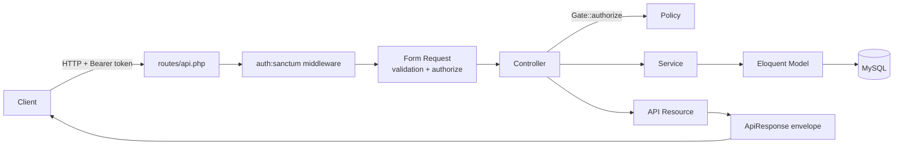
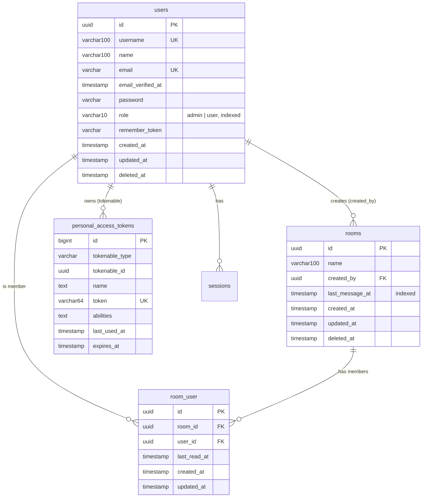

# Live Chat API

A REST API backend for a real-time chat application, built with **Laravel 12**, **Laravel Sanctum** (token authentication), and **Scramble** (auto-generated OpenAPI documentation). Real-time messaging is planned on **Laravel Reverb** (WebSockets).

> **Current state:** authentication, user management, and chat-room management work. Room membership has a database schema but no endpoints yet. Messages and real-time broadcasting are not built yet. See [Project Status](#2-project-status).

---

## Table of Contents

1. [Project Overview & Architecture](#1-project-overview--architecture)
2. [Project Status](#2-project-status)
3. [Installation & Setup](#3-installation--setup)
4. [Environment Configuration](#4-environment-configuration)
5. [Database Migrations](#5-database-migrations)
6. [Broadcasting / WebSocket (Laravel Reverb)](#6-broadcasting--websocket-laravel-reverb)
7. [API Documentation](#7-api-documentation)
8. [Database Schema](#8-database-schema)
9. [Assumptions & Future Improvements](#9-assumptions--future-improvements)

---

## 1. Project Overview & Architecture

### Tech stack

| Layer            | Technology                                   |
| ---------------- | -------------------------------------------- |
| Language         | PHP 8.2+                                     |
| Framework        | Laravel 12                                   |
| Authentication   | Laravel Sanctum 4 (personal access tokens)   |
| API docs         | dedoc/scramble 0.13 (OpenAPI 3.1)            |
| Database         | MySQL (UUID primary keys, soft deletes)      |
| Queue / Cache / Session | Database driver                       |
| Real-time        | Laravel Reverb (planned, not installed yet)  |
| Testing          | Pest 3                                       |

### Request lifecycle

Each request passes through the same layers:



| Layer | Location | Responsibility |
| --- | --- | --- |
| Routes | [routes/api.php](routes/api.php) | Public `login`/`register` routes. Everything else sits behind `auth:sanctum`. `{user}` and `{room}` parameters must be UUIDs (`whereUuid`). |
| Form Requests | [app/Http/Requests/](app/Http/Requests/) | Input validation. Rules switch to `sometimes` on `PUT`/`PATCH` so updates can be partial. |
| Controllers | [app/Http/Controllers/](app/Http/Controllers/) | Thin. They authorize through policies, wrap writes in `DB::transaction`, and delegate to services. |
| Policies | [app/Policies/](app/Policies/) | Authorization rules: admins, owners, and self-access. |
| Services | [app/Services/](app/Services/) | Business logic and queries (pagination, eager loading, password hashing). |
| Models | [app/Models/](app/Models/) | `User` and `Room`. Both use `HasUuids` and `SoftDeletes`. |
| Resources | [app/Http/Resources/](app/Http/Resources/) | Shape the JSON output. |
| Response envelope | [app/Http/Responses/ApiResponse.php](app/Http/Responses/ApiResponse.php) | One JSON format (`success`, `error`, `paginated`) for every endpoint. |
| Exception rendering | [bootstrap/app.php](bootstrap/app.php) | Turns exceptions on `api/*` routes into the same JSON envelope (401/403/404/422/500). |

### Roles & authorization

Roles are defined in [app/Enums/RoleEnum.php](app/Enums/RoleEnum.php): `admin` and `user`.

| Action | User policy | Room policy |
| --- | --- | --- |
| List all | admin | admin |
| View one | admin, or the user themselves | admin, or the room owner |
| Create | admin | any authenticated user |
| Update | admin, or the user themselves* | room owner only |
| Delete | admin, but not on their own account | room owner only |

\* See [Known issues](#known-issues): `UserRequest` currently rejects every write.

### Folder structure

```
app/
├── Enums/RoleEnum.php
├── Http/
│   ├── Controllers/   AuthController, UserController, RoomController
│   ├── Requests/      LoginRequest, RegisterRequest, UserRequest, RoomRequest
│   ├── Resources/     UserResource, RoomResource
│   └── Responses/     ApiResponse
├── Models/            User, Room
├── Policies/          UserPolicy, RoomPolicy
└── Services/          UserService, RoomService
database/
├── factories/         UserFactory, RoomFactory
├── migrations/
└── seeders/           DatabaseSeeder → UserSeeder, RoomSeeder
```

---

## 2. Project Status

### ✅ Done

- [x] Laravel 12 project scaffold with MySQL, plus database-backed queue, cache, and session
- [x] UUID primary keys and soft deletes on `users` and `rooms`
- [x] Token authentication with Sanctum: `register`, `login`, `logout`, `me`
- [x] Role-based access control (`RoleEnum`, `UserPolicy`, `RoomPolicy`)
- [x] User CRUD (admin only), paginated at 10 per page
- [x] Room CRUD with owner-only update and delete
- [x] `GET /rooms/mine`, which lists rooms the current user created
- [x] One JSON response envelope and JSON exception handling for every API route
- [x] Room ↔ User many-to-many schema (`room_user` pivot with `last_read_at`)
- [x] Factories and seeders for users and rooms
- [x] Auto-generated OpenAPI docs with Scramble (`/docs/api`)

### 🚧 In progress

These are inferred from the code: the groundwork exists, but the feature can't be used yet.

- [ ] **Room membership.** The pivot table, `members()` / `rooms()` relations, and `Room::hasMembers()` exist. There are no join, leave, or invite endpoints, the creator is not added as a member automatically, and `RoomPolicy` does not look at membership yet.
- [ ] **API documentation polish.** Scramble generates the spec, but there is no Bearer security scheme, the title is the default `Laravel`, and paginated responses show up as empty arrays.

### 📋 Todo

- [ ] `messages` table, `Message` model, and endpoints (send, list with cursor pagination, edit, delete)
- [ ] Update `rooms.last_message_at` whenever a message is sent
- [ ] Install Laravel Reverb and broadcast `MessageSent` on private room channels
- [ ] Presence channels (online users) and typing indicators
- [ ] Read receipts and unread counts based on `room_user.last_read_at`
- [ ] Fix the [known issues](#known-issues) below
- [ ] Feature tests (Pest) for auth, users, rooms, and policies
- [ ] Rate limiting on `login` and `register`

### Known issues

| # | Issue | Location | Effect |
| --- | --- | --- | --- |
| 1 | `authorize()` compares `auth()->user()->role === RoleEnum::ADMIN->value`. Because `role` is cast to `RoleEnum`, this compares an enum to a string and is always `false`. | [UserRequest.php](app/Http/Requests/UserRequest.php) | `POST /users` and `PUT /users/{id}` always return **403**, even for admins. Fix: use `auth()->user()->isAdmin()`. |
| 2 | `UserResource` doesn't return `id`. | [UserResource.php](app/Http/Resources/UserResource.php) | Clients can't learn user UUIDs, so they can't call `/users/{id}`. |
| 3 | `GET /me` returns the raw model instead of the `ApiResponse` envelope. | [routes/api.php](routes/api.php) | The response shape is inconsistent with every other endpoint. |
| 4 | `room_user.id` is a UUID primary key with no database default, and there is no pivot model that uses `HasUuids`. | [create_room_user_table](database/migrations/2026_11_18_105636_create_room_user_table.php) | `$room->members()->attach($id)` will fail. Fix: add a `RoomUser` pivot model with `HasUuids` and call `->using(RoomUser::class)`. |
| 5 | `->default(Str::uuid())` on `users.id` and `rooms.id` is evaluated **once, when the migration runs**. | migrations | Harmless while `HasUuids` fills the id, but a raw `INSERT` without an id would reuse the same UUID. |
| 6 | `UserFactory` gives each user a random role. | [UserFactory.php](database/factories/UserFactory.php) | The seeded `test@example.com` account may be either `admin` or `user`. |

---

## 3. Installation & Setup

### Requirements

- PHP **8.2+** with `pdo_mysql`, `mbstring`, `openssl`, `tokenizer`, `xml`, `ctype`, `json`, `bcmath`
- Composer 2
- MySQL 8 (or MariaDB 10.6+)
- Node.js 20+ and npm. These are needed only for the Vite assets, or for the Echo client once Reverb is added.
- Optional: [Laragon](https://laragon.org/), which the project was developed with (`c:\laragon\www\live-chat-api-test`)

### Steps

```bash
# 1. Clone
git clone <repository-url> live-chat-api-test
cd live-chat-api-test

# 2. Install PHP dependencies
composer install

# 3. Environment
cp .env.example .env
php artisan key:generate

# 4. Create the database (name must match DB_DATABASE)
mysql -u root -e "CREATE DATABASE live_chat_api_test CHARACTER SET utf8mb4 COLLATE utf8mb4_unicode_ci;"

# 5. Run migrations and seed demo data
php artisan migrate --seed

# 6. Start the API
php artisan serve            # http://localhost:8000
```

You can also use the Composer scripts:

```bash
composer run setup   # install, copy .env, key:generate, migrate, npm install and build
composer run dev     # serve + queue:listen + pail (logs) + vite, run concurrently
composer run test    # run the Pest test suite
```

### Demo accounts

`php artisan db:seed` creates:

| Email | Password | Role |
| --- | --- | --- |
| `test@example.com` (username `testuser`) | `password` | random (see known issue #6) |
| 10 random users | `password` | random |

It also creates 10 rooms owned by random users.

To make the test user an admin:

```bash
php artisan tinker --execute="App\Models\User::where('email','test@example.com')->update(['role'=>'admin']);"
```

### Quick smoke test

```bash
curl -X POST http://localhost:8000/api/login \
  -H "Accept: application/json" -H "Content-Type: application/json" \
  -d '{"email":"test@example.com","password":"password"}'

# use the returned access_token
curl http://localhost:8000/api/rooms/mine \
  -H "Accept: application/json" -H "Authorization: Bearer <token>"
```

> Always send `Accept: application/json`. Without it, some errors would not be rendered as JSON.

---

## 4. Environment Configuration

These are the settings that matter for this project (see [.env.example](.env.example) for the full list):

| Variable | Example | Notes |
| --- | --- | --- |
| `APP_NAME` | `Live Chat API` | Also used as the mail sender name |
| `APP_ENV` | `local` | Scramble docs are only reachable when this is `local` (see [§7](#7-api-documentation)) |
| `APP_KEY` | *(generated)* | `php artisan key:generate` |
| `APP_DEBUG` | `true` | When `false`, 500 errors return `"Internal Server Error"` instead of the exception message |
| `APP_URL` | `http://localhost:8000` | Scramble uses it for the server URL in the spec |
| `DB_CONNECTION` | `mysql` | |
| `DB_HOST` / `DB_PORT` | `127.0.0.1` / `3306` | |
| `DB_DATABASE` | `live_chat_api_test` | Create it before you migrate |
| `DB_USERNAME` / `DB_PASSWORD` | `root` / *(empty)* | Laragon defaults |
| `SESSION_DRIVER` | `database` | Uses the `sessions` table |
| `QUEUE_CONNECTION` | `database` | Uses the `jobs` table. A worker is needed once broadcasting is queued |
| `CACHE_STORE` | `database` | Uses the `cache` table |
| `BROADCAST_CONNECTION` | `log` → `reverb` | Change to `reverb` after following [§6](#6-broadcasting--websocket-laravel-reverb) |
| `BCRYPT_ROUNDS` | `12` | Password hashing cost |

Sanctum settings ([config/sanctum.php](config/sanctum.php)):

- `expiration` is `null`, so **tokens never expire**. Set `SANCTUM_EXPIRATION` (in minutes) or edit the config to limit token lifetime.
- Tokens are created with the name `auth_token` and every ability (`*`).

---

## 5. Database Migrations

### Migration files (in run order)

| File | Creates / changes |
| --- | --- |
| `0001_01_01_000000_create_users_table` | `users` (UUID PK, soft deletes), `password_reset_tokens`, `sessions` |
| `0001_01_01_000001_create_cache_table` | `cache`, `cache_locks` |
| `0001_01_01_000002_create_jobs_table` | `jobs`, `job_batches`, `failed_jobs` |
| `2026_11_18_042203_create_personal_access_tokens_table` | `personal_access_tokens` (uses `uuidMorphs`, because users have UUIDs) |
| `2026_11_18_073901_add_role_to_users_table` | adds `users.role` (`varchar(10)`, default `user`, indexed) |
| `2026_11_18_091739_create_rooms_table` | `rooms` (UUID PK, FK `created_by → users`, soft deletes) |
| `2026_11_18_105636_create_room_user_table` | `room_user` pivot (unique `room_id + user_id`, `last_read_at`) |

### Common commands

```bash
php artisan migrate                 # run pending migrations
php artisan migrate --seed          # migrate, then run DatabaseSeeder
php artisan migrate:status          # show which migrations have run
php artisan migrate:rollback        # undo the last batch
php artisan migrate:fresh --seed    # DROP ALL tables, re-migrate, and seed (dev only!)
php artisan db:seed --class=RoomSeeder
```

> `RoomSeeder` picks a random existing user as each room's `created_by`, so run `UserSeeder` first. `DatabaseSeeder` already does this in the right order.

For production deploys, use `php artisan migrate --force`.

---

## 6. Broadcasting / WebSocket (Laravel Reverb)

> ⚠️ **Not implemented yet.** Reverb is not in `composer.json`, `BROADCAST_CONNECTION` is `log`, and there is no `routes/channels.php` or broadcast event. This section is the setup guide and the planned design.

### 6.1 Install Reverb

```bash
php artisan install:broadcasting --reverb
```

This command:

- requires `laravel/reverb` and publishes `config/broadcasting.php` and `config/reverb.php`
- creates `routes/channels.php` and registers it in `bootstrap/app.php`
- adds the `REVERB_*` / `VITE_REVERB_*` variables to `.env`
- installs `laravel-echo` and `pusher-js` and adds an Echo bootstrap file

### 6.2 Environment

```dotenv
BROADCAST_CONNECTION=reverb

REVERB_APP_ID=123456
REVERB_APP_KEY=your-app-key
REVERB_APP_SECRET=your-app-secret
REVERB_HOST=localhost
REVERB_PORT=8080
REVERB_SCHEME=http

VITE_REVERB_APP_KEY="${REVERB_APP_KEY}"
VITE_REVERB_HOST="${REVERB_HOST}"
VITE_REVERB_PORT="${REVERB_PORT}"
VITE_REVERB_SCHEME="${REVERB_SCHEME}"
```

### 6.3 Authenticate channels with Sanctum tokens

This is a token-based API, so the broadcasting auth route must use `auth:sanctum` instead of the session guard. In [bootstrap/app.php](bootstrap/app.php):

```php
->withBroadcasting(
    __DIR__.'/../routes/channels.php',
    ['prefix' => 'api', 'middleware' => ['auth:sanctum']],
)
```

This exposes `POST /api/broadcasting/auth`.

### 6.4 Planned channels & events

`routes/channels.php`:

```php
use App\Models\Room;
use App\Models\User;
use Illuminate\Support\Facades\Broadcast;

// Private room channel: only members may listen
Broadcast::channel('rooms.{room}', function (User $user, Room $room) {
    return $room->hasMembers($user->id);
});

// Presence channel: who is online in the room
Broadcast::channel('presence.rooms.{room}', function (User $user, Room $room) {
    return $room->hasMembers($user->id)
        ? ['id' => $user->id, 'name' => $user->name]
        : false;
});
```

| Event | Channel | Payload |
| --- | --- | --- |
| `MessageSent` | `private-rooms.{roomId}` | message id, body, sender, `created_at` |
| `MessageUpdated` / `MessageDeleted` | `private-rooms.{roomId}` | message id (and new body) |
| `UserTyping` (client whisper) | `private-rooms.{roomId}` | user id, name |
| `here` / `joining` / `leaving` | `presence-presence.rooms.{roomId}` | member list |

Events should implement `ShouldBroadcast` (queued) and call `->toOthers()` so the sender doesn't receive its own message twice.

### 6.5 Run it

Run these in separate terminals:

```bash
php artisan serve
php artisan reverb:start --debug     # ws://localhost:8080
php artisan queue:listen             # processes queued broadcast jobs
```

### 6.6 Client example (Laravel Echo)

```js
import Echo from 'laravel-echo';
import Pusher from 'pusher-js';
window.Pusher = Pusher;

const echo = new Echo({
  broadcaster: 'reverb',
  key: import.meta.env.VITE_REVERB_APP_KEY,
  wsHost: import.meta.env.VITE_REVERB_HOST,
  wsPort: import.meta.env.VITE_REVERB_PORT ?? 80,
  wssPort: import.meta.env.VITE_REVERB_PORT ?? 443,
  forceTLS: (import.meta.env.VITE_REVERB_SCHEME ?? 'https') === 'https',
  enabledTransports: ['ws', 'wss'],
  authEndpoint: 'http://localhost:8000/api/broadcasting/auth',
  auth: { headers: { Authorization: `Bearer ${token}`, Accept: 'application/json' } },
});

echo.private(`rooms.${roomId}`)
  .listen('MessageSent', (e) => console.log('new message', e));
```

---

## 7. API Documentation

### Interactive docs (Scramble)

| URL | Content |
| --- | --- |
| `http://localhost:8000/docs/api` | Stoplight Elements UI |
| `http://localhost:8000/docs/api.json` | Raw OpenAPI 3.1 document |

Scramble's `RestrictedDocsAccess` middleware only serves the docs when `APP_ENV=local`. To export a static copy:

```bash
php artisan scramble:export --path=api.json
```

The generated spec groups the endpoints under the tags **Auth**, **Room**, and **User**. The examples below come from the actual controller, resource, and `ApiResponse` code. Scramble currently documents paginated endpoints as empty arrays and validation errors in Laravel's default format, so use the shapes below.

### Conventions

- **Base URL:** `http://localhost:8000/api`
- **Headers:** `Accept: application/json`, `Content-Type: application/json`
- **Auth:** `Authorization: Bearer <access_token>` on every endpoint except `login` and `register`
- **IDs:** UUID v7 strings. A non-UUID `{id}` returns 404.
- **Pagination:** 10 items per page. Use `?page=N`.

#### Response envelope

```jsonc
// success
{ "status": 200, "message": "…", "data": { … } }

// paginated
{ "status": 200, "message": "…", "data": [ … ], "links": { … }, "meta": { … } }

// error (the "errors" key is present only for validation errors)
{ "status": 422, "message": "Validation Failed", "errors": { "field": ["…"] } }
```

#### Error responses

| Status | When | Body |
| --- | --- | --- |
| 401 | Missing or invalid token | `{"status":401,"message":"Unauthenticated"}` |
| 401 | Wrong email or password on login | `{"status":401,"message":"Invalid credentials"}` |
| 403 | Policy or Form Request denied the action | `{"status":403,"message":"Forbidden"}` |
| 404 | Unknown route, non-UUID id, or record not found / soft-deleted | `{"status":404,"message":"Data Not Found"}` |
| 422 | Validation failed | `{"status":422,"message":"Validation Failed","errors":{…}}` |
| 500 | Unhandled exception | `{"status":500,"message":"<message or 'Internal Server Error'>"}` |

### Endpoint summary

| Method | Endpoint | Auth | Who | Description |
| --- | --- | --- | --- | --- |
| POST | `/register` | – | public | Register a new `user` account |
| POST | `/login` | – | public | Get a Bearer token |
| POST | `/logout` | ✔ | any | Revoke the current token |
| GET | `/me` | ✔ | any | Current user (raw model) |
| GET | `/users` | ✔ | admin | Paginated list of users |
| POST | `/users` | ✔ | admin | Create a user with any role |
| GET | `/users/{id}` | ✔ | admin / self | Get a user |
| PUT/PATCH | `/users/{id}` | ✔ | admin / self | Update a user (partial) |
| DELETE | `/users/{id}` | ✔ | admin (not self) | Soft-delete a user |
| GET | `/rooms` | ✔ | admin | Paginated list of all rooms |
| GET | `/rooms/mine` | ✔ | any | Paginated list of rooms I created |
| POST | `/rooms` | ✔ | any | Create a room |
| GET | `/rooms/{id}` | ✔ | admin / owner | Get a room |
| PUT/PATCH | `/rooms/{id}` | ✔ | owner | Update a room (partial) |
| DELETE | `/rooms/{id}` | ✔ | owner | Soft-delete a room |

---

### Auth

#### `POST /register`

| Field | Rules |
| --- | --- |
| `name` | required, string, max 100 |
| `username` | required, string, max 100, unique |
| `email` | required, email, max 100, unique |
| `password` | required, string, confirmed |
| `password_confirmation` | must match `password` |

Request:

```json
{
  "name": "John Doe",
  "username": "johndoe",
  "email": "john@example.com",
  "password": "secret123",
  "password_confirmation": "secret123"
}
```

Response `201`:

```json
{
  "status": 201,
  "message": "User registered successfully",
  "data": {
    "name": "John Doe",
    "username": "johndoe",
    "email": "john@example.com",
    "role": "user",
    "created_at": "2026-11-18T10:15:30.000000Z",
    "updated_at": "2026-11-18T10:15:30.000000Z"
  }
}
```

Response `422`:

```json
{
  "status": 422,
  "message": "Validation Failed",
  "errors": {
    "email": ["The email has already been taken."],
    "password": ["The password field confirmation does not match."]
  }
}
```

#### `POST /login`

Request:

```json
{ "email": "john@example.com", "password": "secret123" }
```

Response `200`:

```json
{
  "status": 200,
  "message": "Login successful",
  "data": {
    "access_token": "1|q8X3tH0bJ2kVf9mZ…",
    "token_type": "Bearer"
  }
}
```

Response `401`:

```json
{ "status": 401, "message": "Invalid credentials" }
```

#### `POST /logout`

Revokes only the token used for this request.

Response `200`:

```json
{ "status": 200, "message": "Logged out successfully", "data": null }
```

#### `GET /me`

Returns the authenticated user model **without** the envelope (known issue #3).

Response `200`:

```json
{
  "id": "019a95f2-7c1e-7f3a-9b44-2d6c1e0f8a11",
  "username": "johndoe",
  "name": "John Doe",
  "email": "john@example.com",
  "email_verified_at": "2026-11-18T10:15:30.000000Z",
  "role": "user",
  "created_at": "2026-11-18T10:15:30.000000Z",
  "updated_at": "2026-11-18T10:15:30.000000Z",
  "deleted_at": null
}
```

---

### Users

#### `GET /users?page=1` (admin)

Response `200`:

```json
{
  "status": 200,
  "message": "Users retrieved successfully",
  "data": [
    {
      "name": "John Doe",
      "username": "johndoe",
      "email": "john@example.com",
      "role": "user",
      "created_at": "2026-11-18T10:15:30.000000Z",
      "updated_at": "2026-11-18T10:15:30.000000Z"
    }
  ],
  "links": {
    "first": "http://localhost:8000/api/users?page=1",
    "last": "http://localhost:8000/api/users?page=2",
    "prev": null,
    "next": "http://localhost:8000/api/users?page=2"
  },
  "meta": {
    "current_page": 1,
    "from": 1,
    "last_page": 2,
    "links": [
      { "url": null, "label": "&laquo; Previous", "page": null, "active": false },
      { "url": "http://localhost:8000/api/users?page=1", "label": "1", "page": 1, "active": true },
      { "url": "http://localhost:8000/api/users?page=2", "label": "2", "page": 2, "active": false },
      { "url": "http://localhost:8000/api/users?page=2", "label": "Next &raquo;", "page": 2, "active": false }
    ],
    "path": "http://localhost:8000/api/users",
    "per_page": 10,
    "to": 10,
    "total": 12
  }
}
```

A non-admin gets `403 {"status":403,"message":"Forbidden"}`.

#### `POST /users` (admin)

| Field | Rules (create) | Rules (update) |
| --- | --- | --- |
| `name` | required, string, max 100 | sometimes |
| `username` | required, string, max 100, unique | sometimes, unique (ignores self) |
| `email` | required, email, max 100, unique | sometimes, unique (ignores self) |
| `password` | required, string | sometimes |
| `role` | required, `admin` \| `user` | sometimes |

Request:

```json
{
  "name": "Jane Admin",
  "username": "janeadmin",
  "email": "jane@example.com",
  "password": "secret123",
  "role": "admin"
}
```

Response `201`:

```json
{
  "status": 201,
  "message": "User created successfully",
  "data": {
    "name": "Jane Admin",
    "username": "janeadmin",
    "email": "jane@example.com",
    "role": "admin",
    "created_at": "2026-11-18T11:00:00.000000Z",
    "updated_at": "2026-11-18T11:00:00.000000Z"
  }
}
```

> ⚠️ Because of known issue #1, this endpoint currently returns `403` for every caller.

#### `GET /users/{id}` (admin or self)

Response `200`: `{ "status": 200, "message": "User retrieved successfully", "data": { …UserResource } }`

#### `PUT/PATCH /users/{id}` (admin or self)

Send only the fields you want to change.

Request:

```json
{ "name": "John D." }
```

Response `200`: `{ "status": 200, "message": "User updated successfully", "data": { …UserResource } }`

> ⚠️ Also affected by known issue #1.

#### `DELETE /users/{id}` (admin, not self)

This is a soft delete. The response contains the deleted user.

Response `200`: `{ "status": 200, "message": "User deleted successfully", "data": { …UserResource } }`

---

### Rooms

`RoomResource`:

| Field | Type | Notes |
| --- | --- | --- |
| `id` | uuid | |
| `name` | string | |
| `created_by` | string | The **creator's name**. Only included when the `creator` relation is loaded, so it is missing from the `POST /rooms` response. |
| `last_message_at` | string \| null | Raw DB value, `Y-m-d H:i:s` |

#### `GET /rooms?page=1` (admin) and `GET /rooms/mine?page=1`

Both are sorted by `last_message_at` descending. `/rooms/mine` returns only rooms where `created_by` is the current user.

Response `200`:

```json
{
  "status": 200,
  "message": "Rooms retrieved successfully",
  "data": [
    {
      "id": "019a95f3-1a2b-7c3d-8e4f-5a6b7c8d9e0f",
      "name": "General Discussion",
      "created_by": "John Doe",
      "last_message_at": "2026-11-18 09:42:10"
    }
  ],
  "links": { "first": "…?page=1", "last": "…?page=1", "prev": null, "next": null },
  "meta": { "current_page": 1, "from": 1, "last_page": 1, "links": [ … ], "path": "http://localhost:8000/api/rooms/mine", "per_page": 10, "to": 1, "total": 1 }
}
```

#### `POST /rooms`

| Field | Rules (create) | Rules (update) |
| --- | --- | --- |
| `name` | required, string, max 100 | sometimes |
| `last_message_at` | nullable, date | nullable, date |

`created_by` is always set from the authenticated user.

Request:

```json
{ "name": "General Discussion" }
```

Response `201`:

```json
{
  "status": 201,
  "message": "Room created successfully",
  "data": {
    "id": "019a95f3-1a2b-7c3d-8e4f-5a6b7c8d9e0f",
    "name": "General Discussion",
    "last_message_at": null
  }
}
```

#### `GET /rooms/{id}` (admin or owner)

Response `200`:

```json
{
  "status": 200,
  "message": "Room retrieved successfully",
  "data": {
    "id": "019a95f3-1a2b-7c3d-8e4f-5a6b7c8d9e0f",
    "name": "General Discussion",
    "created_by": "John Doe",
    "last_message_at": "2026-11-18 09:42:10"
  }
}
```

#### `PUT/PATCH /rooms/{id}` (owner)

Request:

```json
{ "name": "General Chat" }
```

Response `200`:

```json
{
  "status": 200,
  "message": "Room updated successfully",
  "data": {
    "id": "019a95f3-1a2b-7c3d-8e4f-5a6b7c8d9e0f",
    "name": "General Chat",
    "created_by": "John Doe",
    "last_message_at": "2026-11-18 09:42:10"
  }
}
```

#### `DELETE /rooms/{id}` (owner)

This is a soft delete. The response contains the deleted room.

Response `200`: `{ "status": 200, "message": "Room deleted successfully", "data": { …RoomResource } }`

---

## 8. Database Schema



### Domain tables

**`users`**: application accounts.
- `id` is a UUID (v7, generated by `HasUuids`).
- `username` and `email` are unique.
- `role` is stored as a string and cast to `RoleEnum` (`admin` / `user`). The default is `user`.
- `password` is bcrypt-hashed.
- `deleted_at` enables soft deletes. Soft-deleted users can't log in and return 404.

**`rooms`**: chat rooms.
- `created_by` is a FK to `users.id` with `ON DELETE CASCADE` (this only fires on a hard delete).
- `last_message_at` is indexed and used to sort room lists newest-first. Once messages exist, it will be updated whenever one is sent.
- `deleted_at` enables soft deletes. The `creator` relation uses `withTrashed()`, so a room still shows its creator's name after that user is soft-deleted.

**`room_user`**: many-to-many membership between users and rooms.
- `(room_id, user_id)` is unique, so a user can join a room only once.
- `last_read_at` is the per-member read pointer, which will be used for unread counts.
- Both FKs cascade on hard delete.
- Relations: `Room::members()` and `User::rooms()`, both with pivot `last_read_at` and timestamps.

### Framework tables

| Table | Purpose |
| --- | --- |
| `personal_access_tokens` | Sanctum tokens. `uuidMorphs('tokenable')` because users have UUID keys. |
| `sessions` | Database session driver (`user_id` is a UUID) |
| `password_reset_tokens` | Password reset (not exposed through the API yet) |
| `cache`, `cache_locks` | Database cache store |
| `jobs`, `job_batches`, `failed_jobs` | Database queue (will carry broadcast jobs) |

### Planned: `messages`

| Column | Type | Notes |
| --- | --- | --- |
| `id` | uuid PK | |
| `room_id` | uuid FK → rooms | cascade, indexed together with `created_at` |
| `user_id` | uuid FK → users | sender |
| `body` | text | |
| `type` | varchar | `text`, `image`, `system`, … |
| `edited_at` | timestamp nullable | |
| `created_at` / `updated_at` / `deleted_at` | timestamps | soft delete |

---

## 9. Assumptions & Future Improvements

### Assumptions

- **Stateless API clients.** Authentication uses Sanctum personal access tokens (Bearer), not SPA cookie auth. Tokens never expire unless `SANCTUM_EXPIRATION` is set.
- **Two global roles.** `admin` manages all users and can see every room. `user` manages only their own profile and rooms. There are no per-room roles (such as room admin or moderator) yet.
- **Public registration always creates a `user`.** Only an admin can create another admin, through `POST /users`.
- **Email is trusted.** `email_verified_at` is set to `now()` when a user is created. There is no verification flow.
- **The room creator is the owner.** Only the creator can rename or delete a room. Admins can view any room but cannot edit or delete it.
- **Soft deletes everywhere.** Deleted users and rooms stay in the database for audit and recovery and are hidden from queries.
- **UUIDs for all public identifiers.** This prevents ID enumeration and makes distributed inserts safe.
- **Fixed page size of 10.** Clients can't change it yet.
- **MySQL is the target database.** Session, cache, and queue use the database driver, so no Redis is needed in development.
- **`last_message_at` can be set by the client** on room create and update. This is a temporary choice until messages exist and the server maintains it.

### Future improvements

**Features**
- Messages module (CRUD plus cursor pagination for chat history)
- Room membership endpoints: `POST /rooms/{id}/members`, `DELETE /rooms/{id}/members/{userId}`, `POST /rooms/{id}/join`, `POST /rooms/{id}/leave`
- `GET /rooms/mine` should return rooms the user is a **member** of, not only rooms they created
- Real-time features with Reverb: new messages, edits and deletes, typing indicators, online presence, and read receipts
- Unread message counts per room from `last_read_at`
- Direct (1-on-1) rooms vs. group rooms (`rooms.type`)
- File and image attachments
- Password reset and email verification endpoints
- Token refresh / expiry and "log out of all devices"

**Code quality and fixes**
- Fix the [known issues](#known-issues), especially the `UserRequest` authorization and the missing `id` in `UserResource`
- Wrap `/me` in `ApiResponse` and `UserResource`
- Cast `rooms.last_message_at` to `datetime` so timestamps are always ISO-8601
- Remove the duplicate password hashing (the `hashed` cast plus `bcrypt()` in `UserService`)
- Add a minimum password length and strength rules (`Password::defaults()`)
- Let `RoomPolicy::view` allow room members, not only the owner
- Configure Scramble: Bearer security scheme, API title and version, and documented pagination
- Put the `UserService` and `RoomService` contracts behind interfaces so they can be mocked

**Operations**
- Pest feature tests for every endpoint and policy, plus CI (GitHub Actions)
- Rate limiting (`throttle:api`, stricter on `login` and `register`)
- Redis for cache, queue, and Reverb horizontal scaling
- Docker / Laravel Sail setup
- Supervisor configs for `queue:work` and `reverb:start` in production
- API versioning (`/api/v1`)

---

## License

MIT
